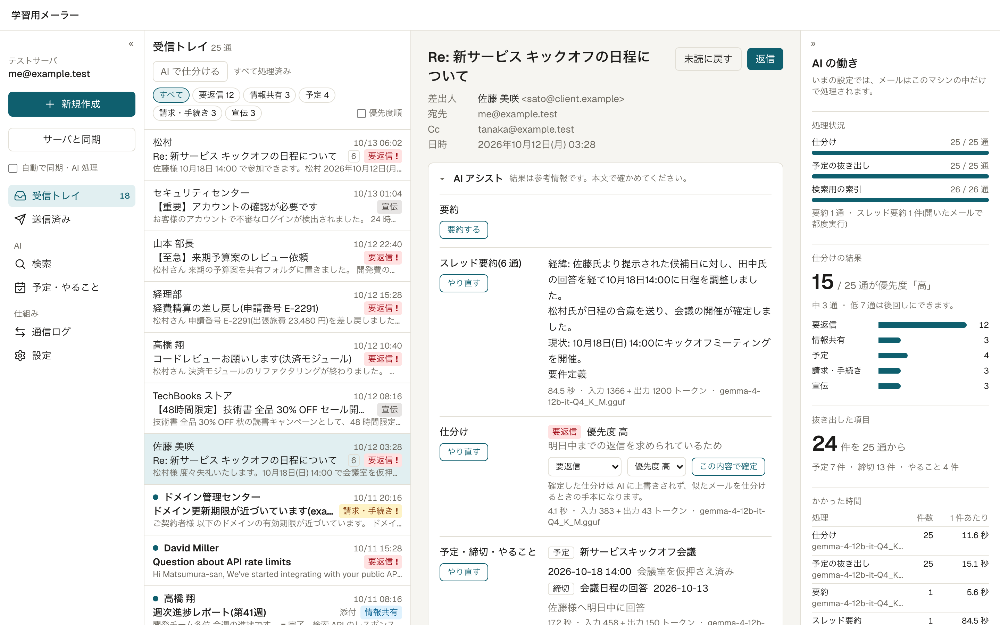
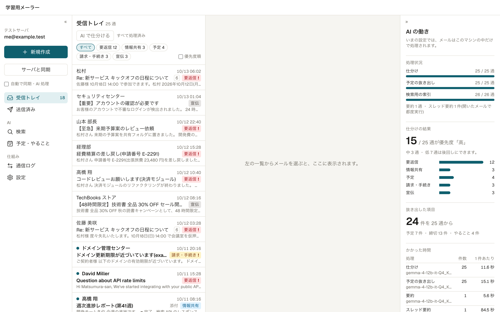
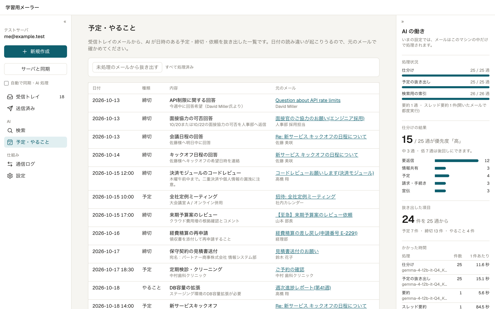

# 学習用メーラー

ローカル AI を組み込んだ、IMAP / SMTP のメールクライアントです。メールの仕組み(IMAP・SMTP のやりとり)と、ローカル AI の使いどころを手元で確かめるために作りました。

要約・仕分け・予定の抜き出し・意味検索・返信の下書きを、**このマシンの中の AI だけで**行います。メールの本文を外部の AI サービスへ送りません。



## できること

### メール
- IMAP で受信トレイと送信済みを同期し、SMTP で送信・返信します(スレッド表示つき)
- 「通信ログ」で、IMAP / SMTP のコマンドとサーバの応答を 1 行ずつ確かめられます(認証情報は伏せて記録します)
- 学習用のテストメールサーバ(GreenMail)と、サンプルメールを同梱しています。外部には一切配送されません
- 実際のメールアカウント(Gmail など)もつなげます。検証中にメールボックスを変えないよう、**読み取り専用モード**(既定でオン)があります

### ローカル AI
| 機能 | 内容 |
|---|---|
| 要約 | 1 通の要約と、スレッド全体の要約 |
| 仕分け | 「要返信・情報共有・予定・請求・手続き・宣伝」と、優先度(高・中・低) |
| 予定・やること | 日時のある予定・締切・依頼を抜き出し、一覧にします |
| 意味検索 | 言葉が違っても、意味の近いメールを探します(埋め込み) |
| 返信の下書き | 口調(丁寧・簡潔・カジュアル)を選んで下書きします。送信は人が確かめてから |
| 自動処理 | 画面を開いている間、5 分ごとに同期し、新着を順に処理します |

- 右側の「AI の働き」パネルに、処理の進み具合・仕分けの結果・かかった時間を表示します
- AI の結果には、かかった時間・トークン数・モデル名を添えます。便利さと待ち時間を見比べるためです

### 使うほど速くなる仕分け
仕分けは、まず**似たメールの仕分けから推定**します(検索用の埋め込みを使う近傍法。1 通あたり数ミリ秒)。似たメールの仕分けが割れているときや、見たことのない種類のメールだけ、会話用モデルに聞きます。

- 仕分けは画面で確定・修正できます。確定した仕分けは AI に上書きされず、次から似たメールを仕分けるときの手本になります
- `npm run ai:eval` で、確定した仕分けを正解として、近傍法と会話用モデルの正解率を測れます





## 必要なもの

- **Node.js 22.13 以上**(`node:sqlite` を使うため。開発は Node.js 25 で行っています)
- **Docker**(テストメールサーバを動かす場合)
- **OpenAI 互換 API のローカル AI サーバ**(llama-server・LM Studio・Ollama など)
  - 会話用モデル: 開発では Gemma 4 12B(Q4_K_M)を使っています
  - 埋め込み用モデル: 開発では bge-m3 を使っています(日本語を含む多言語に対応)
- 実アカウントをつなぐ場合は **macOS**(パスワードをキーチェーンに保存するため)

## はじめかた

```bash
npm install

# テストメールサーバを起動し、サンプルメールを入れる
npm run mail:up
npm run mail:seed

# AI の接続先を設定する(設定画面からも変更できます)
cp .env.example .env.local

# 開発サーバを起動する
npm run dev
```

http://127.0.0.1:3000 を開き、「サーバと同期」を押すとサンプルメールが届きます。続けて AI の処理(索引 → 仕分け → 予定の抜き出し)が始まります。

AI の接続先とモデルは、設定画面の「ローカル AI」で変えられます。

| サーバ | ベース URL の例 |
|---|---|
| llama-server | `http://localhost:8080/v1` |
| LM Studio | `http://localhost:1234/v1` |
| Ollama | `http://localhost:11434/v1` |

llama-server のように会話用と埋め込み用でサーバが分かれる場合は、「埋め込み用のベース URL」に埋め込みモデルのサーバを指定します。

## 実際のメールアカウントをつなぐ

設定画面の「実アカウントの設定」に、アドレス・パスワード・IMAP / SMTP のサーバを入力します。「接続を確かめる」で、保存する前にログインできるかを試せます。

- **パスワードは macOS のキーチェーンにだけ保存**し、データベースや画面には残しません
- Gmail などでは、通常のパスワードではなく「アプリ用パスワード」が必要です(2 段階認証を有効にしてから発行します)
- IMAP 993・SMTP 465 以外のポートでは STARTTLS を必須にし、暗号化できなければパスワードを送りません
- 接続先かログイン名を変えたときは、パスワードの入れ直しを求めます(保存済みのパスワードを別のサーバへ送らないため)

**読み取り専用モード**(実アカウントでは既定でオン)の間は、サーバのメールボックスに一切書き込みません。メールは取り込むだけでサーバに残り、既読・未読はこのアプリの中だけで記録します。送信もしません。

Gmail の例:

| 項目 | 値 |
|---|---|
| IMAP | `imap.gmail.com` / 993 |
| SMTP | `smtp.gmail.com` / 465 |
| 送信したメールの控えを保存 | オフ(Gmail はサーバが自動で保存します) |

## コマンド

| コマンド | 内容 |
|---|---|
| `npm run dev` | 開発サーバを起動する(127.0.0.1 でだけ待ち受け) |
| `npm run mail:up` / `mail:down` | テストメールサーバ(GreenMail)を起動・停止する |
| `npm run mail:seed` | テストメールサーバにサンプルメールを入れる |
| `npm run ai:eval [local\|real]` | 仕分けの精度を測る(DB には書き込みません) |
| `npm run typecheck` / `npm run lint` | 型チェックと lint |

## セキュリティとプライバシー

- 自分のマシンで 1 人で使う前提のアプリです。**ログイン機能はありません**。127.0.0.1 でだけ待ち受けるので、ネットワークに公開しないでください
- 取り込んだメールは `data/mailer.db`(SQLite)に保存します。このマシンの他の利用者からは読めない権限(0600)にしています
- 通信ログには、実際のメールの本文も記録されます
- AI の接続先にこのマシンの外の URL を指定すると、設定画面で警告します。その場合、要約や検索のたびにメールの本文がその宛先へ送られます

## まだできないこと

- 添付ファイルの保存、削除・アーカイブ、受信トレイと送信済み以外のフォルダ
- 初回の同期より古いメール(各フォルダとも最新 100 通まで)の取り込み
- 送信での添付・Bcc・下書きの保存
- 実アカウントのパスワードの保存(macOS 以外)

## 技術構成

Next.js 16(App Router)・React 19・SQLite(`node:sqlite`)・[ImapFlow](https://github.com/postalsys/imapflow)・[Nodemailer](https://nodemailer.com/)・[GreenMail](https://greenmail-mail-test.github.io/greenmail/)

```
app/          画面とサーバアクション、AI の API(app/api/ai)
components/   画面の部品
lib/mail/     IMAP の同期、SMTP の送信、通信ログ
lib/ai/       ローカル AI の呼び出し、プロンプト、近傍法の仕分け
scripts/      サンプルメールの投入、仕分けの評価
```

## ライセンス

[MIT](LICENSE)
